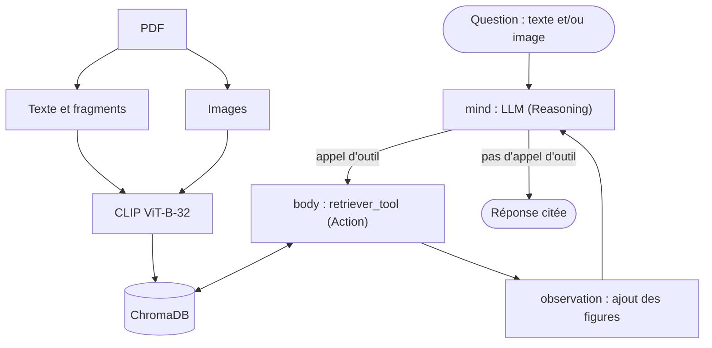

# TP — RAG multimodal et agentique

**Réalisé par :** Aliaa CHIBEL — **Encadrant :** Pr. Mohamed YOUSSFI

Agent capable d'extraire, d'indexer et d'interroger de façon autonome le texte et les images de l'article
*Attention Is All You Need*. Tout le travail se trouve dans le notebook
[`rag_multimodal_agentique_chibel.ipynb`](rag_multimodal_agentique_chibel.ipynb).

## Architecture



## Correspondance avec l'énoncé

Le notebook suit la structure et le code du notebook de cours, avec une section par étape de l'énoncé.

| Étape | Réalisation |
|---|---|
| 1. Extraction | PyMuPDF : texte par page, fragments d'environ 60 tokens, images sauvegardées |
| 2. Embeddings | CLIP `ViT-B-32` (`laion2b_s34b_b79k`) via `open_clip`, vecteurs normalisés |
| 3. Indexation | ChromaDB, identifiant SHA-256, métadonnées (type, page, chemin) |
| 4. Recherche | Similarité cosinus, requête texte ou image, affichage des `k` meilleurs résultats |
| Query et Generation | `recuperer_sources`, `generer_reponse` et `rag()`, avec 14 tests |
| 5. Outil | `retriever_tool`, avec description et schéma d'arguments pour guider le LLM |
| 6. Agent | `StateGraph` LangGraph : `mind`, `body`, `observation` (cycle ReAct) |
| 7. Tests | Interrogation de l'agent, 8 scénarios avec trace de chaque décision et bilan |

## Résultats

Exécution enregistrée dans le notebook (le LLM n'étant pas déterministe, les réponses peuvent varier) :

- L'agent décide correctement d'appeler ou non l'outil, et choisit le type de recherche selon la demande.
- La recherche par texte et par image fonctionne, et l'information absente de l'article est bien signalée.
- Limites relevées : des citations de page imprécises et une information présente dans l'article mais non récupérée (`d_ff`, test 11 du RAG). L'analyse complète se trouve à la fin du notebook.

## Exécution

Testé sous Windows avec Python 3.12, sur CPU.

```bash
python -m venv .venv
.venv\Scripts\activate
pip install -r requirements.txt
echo GEMINI_API_KEY=votre_cle> .env
jupyter notebook rag_multimodal_agentique_chibel.ipynb
```

Le PDF est téléchargé automatiquement au premier lancement. Les poids de CLIP (environ 600 Mo) le sont aussi.
Le LLM est `gemini-3.5-flash-lite`, appelé via `langchain-google-genai`. Une clé s'obtient sur
[Google AI Studio](https://aistudio.google.com/apikey). Le modèle se change avec la variable `MODELE_LLM` : il doit
accepter les images et les appels d'outils.
